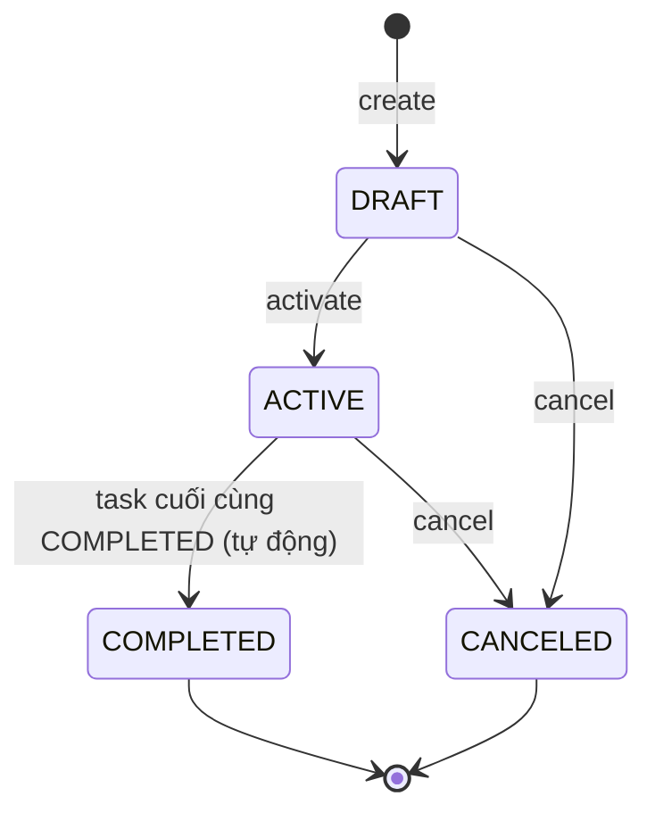
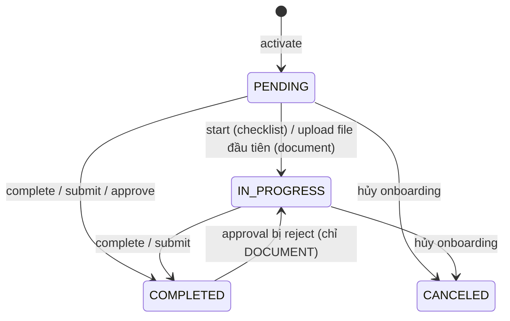
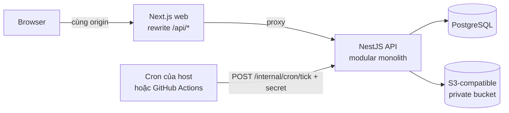

# Joinpath — Kế hoạch triển khai v0.29

> **Joinpath**: Employee Onboarding & Workflow Management Platform, dự án portfolio Full-stack.
> Bản này tinh chỉnh SRS v0.4 trong thread ChatGPT "Thiết kế dự án onboarding" (14/10/2026).
> Nguyên tắc: **giữ nguyên mọi quyết định bạn đã chốt ở vòng 1–4**. Phần sửa chỉ gồm: vá lỗ hổng, cắt phần thừa, và bổ sung những gì chính các quyết định đó đòi hỏi. Danh sách thay đổi nằm ở §2.
> **v0.6 (14/10/2026):** đã chốt toàn bộ §15; roadmap tính lại theo 40 giờ/tuần (§13).
> **v0.7 (14/10/2026):** stack ghi theo phiên bản đã kiểm tra trên npm (§6.2); UI dùng token và motion của beUI (§6.2, §10, ADR 009).
> **v0.8 (14/10/2026):** icon lấy từ reicon; mọi control dùng component beUI có sẵn, chỉ tự dựng phần beUI không có; thanh demo đổi thành Dynamic Island (§6.2, §10, ADR 010).
> **v0.9 (14/10/2026):** hover của nav và dòng danh sách dùng chung một lớp phủ 5% (8% khi nhấn); active nav dùng tint primary (§6.2, ADR 009).
> **v0.10 (15/10/2026):** deploy lên Vercel (Services: web + api trong một project, region sin1) + Neon; ở production, router của Vercel thay rewrite của Next; throttle login tự viết; chốt người gọi cron dời sang M3.2 (§6.1, §6.2, §6.5, §6.6, §9, ADR 011).
> **v0.11 (15/10/2026):** `validateTemplate` trả mỗi vấn đề một lỗi, gắn với các task liên quan; BR-T04 thêm điều kiện title không trùng; BR-T07 tính cả prerequisite gián tiếp; thứ tự task trong phase là thứ tự trong mảng, snapshot vào cột mới `tasks.position` (§4.2, §5, §7).
> **v0.12 (15/10/2026):** overdue không bao giờ đi cùng LOCKED_BY_DATE (§4.4); override lúc activate không áp dụng cho task `NEW_HIRE` và không giao task cho chính nhân viên mới; activation kiểm BR-R01 (§4.7); `GET /employees` lọc theo `active`, `role` tùy chọn (§8).
> **v0.13 (15/10/2026):** partial unique index khai báo ngay trong Prisma schema (preview `partialIndexes`), CHECK vẫn viết SQL tay (§6.2); `POST /templates` tạo kèm DRAFT v1 rỗng; archive không đảo ngược; mọi route template chỉ dành cho HR, kể cả GET (§8).
> **v0.14 (15/10/2026):** bỏ `tasks.completed_by`, vì chỉ assignee complete được task nên cột này luôn trùng `assignee_employee_id` (§7); body của `POST` và `PATCH /onboardings`, draft hiện bản published mới nhất (§8); người không phải HR không thấy onboarding DRAFT, còn ai có task trong một onboarding thì xem được onboarding đó (§9).
> **v0.15 (15/10/2026):** preview là `GET` không nhận lựa chọn của HR; wizard giữ lựa chọn và gửi một lần trong body của activate, `assignees` tùy chọn (§4.7); shape của preview, activate trả chi tiết onboarding kèm task, `details` của 422 (§8).
> **v0.16 (15/10/2026):** `start`, `complete` chỉ cho CHECKLIST, kiểm theo thứ tự cố định, trả chi tiết onboarding; `GET /tasks/mine` trả `{today, tasks}`, client chia tab theo availability; `POST /demo/clock/advance` nhận 1–30 ngày, mọi vai trong sandbox, trả `{today}` (§8).
> **v0.17 (15/10/2026):** mỗi dòng của `GET /onboardings` kèm `progress {completed, total, overdue}` và `nextTask`; onboarding kèm `completedAt` (§8); bảng tự dựng theo token thay cho `table` của beUI, TanStack Table chỉ thêm khi cần sort, lọc, phân trang (§6.2, §10.1, ADR 010).
> **v0.18 (15/10/2026):** `GET /auth/me` kèm ngày nghiệp vụ `organization.today` (§8); wizard: chọn nhân viên trong bảng có radio, template bằng thẻ `radio`, start date bằng lịch `date-range-picker` chế độ một ngày, override bằng nút Change mở `select` (§10.1, ADR 010).
> **v0.19 (15/10/2026):** Onboarding detail hiện task theo phase bằng `todo-list` (sửa tại chỗ: dòng `meta` dưới tên task, mỗi khối mang tên phase), không dùng bảng tự dựng; My Tasks chia tab bằng `tabs` (§10.1, ADR 010).
> **v0.20 (15/10/2026):** HR thêm và đổi tên phòng ban (`POST /departments`, `PATCH /departments/:id`, không xóa), tạo và sửa hồ sơ nhân viên: email lưu chữ thường, chỉ đổi được khi người đó chưa có tài khoản; manager không được là chính họ hay người báo cáo cho họ; `GET /auth/me` kèm `organization.emailDomain` (§8); màn Employees dùng `tabs`, `input`, `select` và bảng tự dựng (§10.1).
> **v0.21 (15/10/2026):** màn Templates chỉ xem (M1.9): bảng tự dựng, mỗi dòng liệt kê các version, mới nhất trước, và đánh dấu Current cho bản mà onboarding mới sẽ dùng; template chưa publish hoặc đã archive mang badge (§10.1).
> **v0.22 (15/10/2026):** roadmap ước lượng lại theo số session sau M1, M2 chia thành 7 session (§13); thêm `POST /auth/invitations/lookup` để trang nhận lời mời hiện thông tin trước khi đặt mật khẩu, link mời mang token sau `#`; mật khẩu tự đặt dài 8–200 ký tự; đổi email của người mới làm lời mời đang chờ mất hiệu lực; `invitations` gắn với onboarding và ghi email lúc gửi, `mock_emails` thêm tên người nhận và nhãn nút (§5, §7, §8, §9).
> **v0.23 (15/10/2026):** `mock_emails` thêm `footer`, phần chữ nằm dưới nút như trên canvas (§7); trang nhận lời mời dựng form từ `input`, không dùng `signup-form`, vì `signup-form` luôn có ô Name, Email sửa được và checkbox Terms; thanh độ mạnh mật khẩu là phần tự dựng (§10.1, ADR 010).
> **v0.24 (16/10/2026):** local và CI chạy RustFS thay cho MinIO: MinIO ngừng phát hành image từ 10/2025, image cũ không còn tải được (kiểm ở M2.2); client S3 là `aws4fetch`; provider cho production chốt ở M2.5 (§6.2, §6.3, §6.6, §12, §13). Upload một file mỗi request, trả chi tiết onboarding; mỗi task kèm `files`, các file chưa submit mà người xem được xem (BR-P03); `GET /files/:id/download-url` trả `{url, expiresAt}` (§8).
> **v0.25 (16/10/2026):** reject chép các file của revision bị reject sang bản nháp của revision mới: dòng mới, dùng chung object, nên object chỉ bị xóa khi không còn dòng nào trỏ tới (§4.5, §7). Submit, approve, reject: thứ tự kiểm, mã lỗi, trả chi tiết onboarding; mỗi DOCUMENT kèm `submissions` (revision, file, quyết định) theo quyền xem file, file kèm `carriedOver` (§8, §9).
> **v0.26 (16/10/2026):** `GET /auth/me` kèm `onboardingId`: onboarding ACTIVE của chính người đó, nếu không có thì bản COMPLETED mới nhất (§8). Có `onboardingId` thì `/`, đăng nhập và nhận lời mời đưa tới portal `/my-onboarding`, nằm ngoài app shell (§10). Portal dùng `todo-list` (sửa tại chỗ: `body` dưới dòng của task) và `file-upload` (sửa tại chỗ: `note`, `queueLabel`, thanh progress, nút Remove) (§10.1, ADR 010).
> **v0.27 (16/10/2026):** xem file đã nộp bằng `morphing-lightbox`, thay `image-viewer` (không có trên registry): ảnh xem trước qua signed URL, PDF chỉ tải về vì link ký kèm `Content-Disposition: attachment`. Drawer review mở từ My Tasks; `drawer` render qua portal và giữ focus bằng `useModalScope`, `approval-card` có `meta` thay badge trạng thái (sửa tại chỗ). Task DOCUMENT làm ngay trong My Tasks bằng khối của portal (§10.1, ADR 010).
> **v0.28 (16/10/2026):** storage của production là Cloudflare R2. Path-style URL không dùng được với mọi provider: Tigris bỏ path-style cho bucket tạo từ 19/02/2025 (§6.2, ADR 008). M2 xong sau 7 session (§13).
> **v0.29 (16/10/2026):** M3 chia thành 8 session (§13). Hủy chỉ khóa tài khoản mà người mới có được qua lời mời; activate một onboarding mới cho người đó mở lại tài khoản (BR-C03). Assignee hiện tại của DOCUMENT xem được file và revision của nó (BR-P03, §9). Reschedule, cancel, reassign, due-date: thứ tự kiểm, mã lỗi, audit; task kèm `dueOverridden`; lệnh trên task kiểm lại assignee sau khi khóa (§8).

## TL;DR: 6 thay đổi lớn nhất

1. **Mỗi khách xem demo có sandbox riêng và đồng hồ có thể tua.** Nếu public demo dùng chung dữ liệu, khách sẽ giẫm chân nhau. Còn task bị khóa theo ngày thì khách không thể ngồi chờ tới ngày đi làm. Vì vậy mỗi khách nhận một organization riêng (dùng thật thiết kế tenant-ready) kèm nút "+1 ngày".
2. **Bỏ outbox và app worker.** Notification và mock email đều là row trong cùng PostgreSQL, nên ghi chung một transaction là đã nhất quán. Các việc định kỳ dồn vào một endpoint cron idempotent.
3. **Concurrency được định nghĩa cụ thể:** compare-and-set, khóa dòng onboarding và unique constraint, thay cho cụm "idempotency key / row locking" chung chung. Cách này vá luôn race "2 task cuối hoàn thành cùng lúc làm onboarding kẹt ở ACTIVE".
4. **Mô hình gọn hơn:** task luôn giao theo `employee_id`; approval là một loại task; template lưu dạng JSON bất biến; Manager là quan hệ báo cáo.
5. **Vá các lỗ hổng:** chọn assignee khi một role có nhiều người, gửi lại invitation, cookie khác domain và CSRF, `startDate` lưu trùng, deadline đã override khi đổi ngày bắt đầu.
6. **Roadmap theo vertical slice:** deploy walking skeleton ngay tuần 1; làm engine trước (dùng template từ seed), editor UI sau; có mốc an toàn, cut line và thứ tự cắt.

---

## 1. Những gì đã chốt (không đổi)

| Chủ đề | Quyết định | Vòng |
|---|---|---|
| Mục tiêu | Portfolio Full-stack, public demo, dữ liệu giả | 1 |
| Tenancy | Single-company, tenant-ready | 2 |
| Phạm vi | Preboarding + Onboarding (từ lúc nhận offer đến khi hoàn thành) | 1 |
| Người dùng | HR, Manager, IT, Employee | 1 |
| Workflow | Template cấu hình được, gồm phases + task dependencies (không conditional, không BPMN) | 1, 2 |
| Loại task | Checklist, Document, Approval | 2 |
| Giao việc | Hybrid: template định nghĩa theo vai trò; khi kích hoạt thì resolve hoặc override thành người cụ thể | 2 |
| Deadline | Calendar days, offset tính theo start date, cấu hình riêng từng task | 2, 4 |
| Nhân viên mới vào hệ thống | Trước ngày đi làm, qua invitation và tự đặt mật khẩu | 2, 4 |
| Kích hoạt | HR tạo draft, kiểm tra, rồi activate thủ công | 2 |
| Thông báo | In-app + mock email; theo sự kiện, kèm nhắc due-soon và overdue | 2, 4 |
| Mở khóa task | Theo ngày + dependency, dependency kiểu ALL | 3 |
| Document và Approval | Hai task riêng; approval là task phụ thuộc vào document | 3 |
| Approval bị reject | Rework rồi resubmit (mở lại task nguồn) | 3 |
| Không resolve được assignee | Chặn activation | 3 |
| Đổi start date | Tính lại task chưa xong; task đang IN_PROGRESS không bị khóa lại | 3, 4 |
| Hủy | Cancel workflow, giữ lịch sử (không có pause/resume hay restart) | 3 |
| Sửa template đã publish | Tạo version mới; onboarding đang chạy giữ version cũ | 3 |
| Đăng nhập demo | Tài khoản demo + invitation flow | 3 |
| Approver | Một người; HR reassign được | 4 |
| Tài liệu | File thật, private storage, quyền xem theo need-to-know | 4 |
| HR sửa sau khi ACTIVE | Reassign và chỉnh deadline của task chưa xong | 4 |
| Hoàn thành | Mọi task completed, không có optional task | 4 |
| Tên, kiến trúc nền | Joinpath; Modular monolith gồm Next.js + NestJS + PostgreSQL/Prisma (ChatGPT đề xuất, bạn không phản đối nên giữ nguyên) | — |

---

## 2. Thay đổi so với v0.4

Cột **Nguồn** ghi điểm bị thay đổi xuất phát từ đâu: `GPT` là mặc định hoặc đề xuất của ChatGPT mà bạn chưa xác nhận; `Mới` là điểm chưa có trong thread. Không dòng nào đụng tới quyết định ở §1.

### 2.1 Vá lỗ hổng và mâu thuẫn

| # | Vấn đề trong v0.4 | Cách sửa | Nguồn |
|---|---|---|---|
| F1 | Role có nhiều người (vd 2 người IT) thì ai nhận task? v0.4 chưa có quy tắc | Có đúng 1 ứng viên thì tự chọn; nhiều ứng viên thì HR **bắt buộc** chọn ở bước preview; 0 ứng viên thì chặn activation (đúng quyết định vòng 3). Không làm round-robin | Mới |
| F2 | Template cho gán "một HR user cụ thể", trong khi version đã publish là bất biến. Người đó nghỉ việc thì version hỏng, phải tạo version mới chỉ để đổi người | Template chỉ chứa rule (`NEW_HIRE`, `DIRECT_MANAGER`, `ROLE`); người cụ thể được chọn lúc activate hoặc reassign. Vẫn đúng với Hybrid assignment | GPT |
| F3 | Invitation hết hạn sau 72h nhưng không có cách gửi lại, nhân viên mới bị kẹt | Thêm lệnh `resend-invitation`, đồng thời vô hiệu token cũ | Mới |
| F4 | Session cookie trong khi web và API nằm ở hai domain: cookie trở thành cookie bên thứ ba và bị chặn (Safari mặc định, Chrome ẩn danh), login hỏng | Gọi API qua rewrite `/api/*` của Next.js để cookie là first-party. Thêm chống CSRF (v0.4 chưa nhắc tới): `SameSite=Lax` + kiểm tra header `Origin` | Mới |
| F5 | `startDate` nằm ở cả `employees` lẫn `onboardings` | Chỉ giữ `onboardings.start_date` | GPT |
| F6 | Onboarding ở DRAFT dùng version nào khi template vừa ra version mới? | Activate luôn dùng version published mới nhất; request gửi kèm `templateVersionId` đã preview, nếu lệch thì trả 409 | Mới |
| F7 | HR đã override deadline, sau đó đổi start date: deadline override có thể rơi trước `available_on` mới | Giữ override, trừ khi nó sớm hơn `available_on` mới; khi đó reset về giá trị tính theo template và ghi audit | Mới |
| F8 | Cancel không xử lý tài khoản của nhân viên mới | Thu hồi invitation; khóa account và xóa session của nhân viên mới | Mới |
| F9 | Approval có thể giao cho chính người upload (tự duyệt) | Chặn ở bước publish (APPROVAL không được gán `NEW_HIRE`) và khi reassign (approver phải khác assignee của task nguồn) | Mới |
| F10 | Task phụ thuộc trực tiếp vào DOCUMENT đang chờ duyệt: khi reject thì phải rollback cả nhánh khác. v0.4 mới chỉ "cảnh báo" | Nâng thành lỗi publish: một DOCUMENT được review chỉ được có APPROVAL của nó làm dependent | GPT |
| F11 | Race: 2 task cuối hoàn thành đồng thời, transaction nào cũng thấy task kia chưa xong, onboarding kẹt ở ACTIVE mãi | Mọi lệnh thay đổi task phải khóa dòng onboarding trước (§6.4) | Mới |
| F12 | Có 2 hệ đánh số BR (BR-01… và BR-001…), danh sách EC và AC tách rời nhau | Gộp thành 1 catalog BR (§5) và 1 bảng acceptance test trỏ về BR (§12) | — |

### 2.2 Đơn giản hóa (cắt bớt mà không mất giá trị portfolio)

| # | v0.4 | v0.5 | Lý do |
|---|---|---|---|
| S1 | `outbox_events` + `apps/worker` polling bằng `SKIP LOCKED` | Ghi notification và mock email trong cùng transaction; các việc định kỳ gom vào `POST /internal/cron/tick` | Outbox chỉ cần khi có side effect ra ngoài DB. Khi gắn email thật, chỉ cần thêm cột `status` vào `mock_emails` là bảng này thành outbox |
| S2 | 3 bảng `phase/task/dependency_definitions`, CRUD từng dòng | `template_versions.definition` (JSON), validate bằng Zod + DAG validator dùng chung cho FE và BE; editor `PUT` nguyên bản định nghĩa | Định nghĩa là một document bất biến sau khi publish; chỉ phần execution mới cần relational |
| S3 | Resource `/approvals/*` riêng | Approval là một `type` của task: `/tasks/:id/approve`, `/tasks/:id/reject`; bảng `approval_decisions` chỉ lưu lịch sử quyết định | Bớt một resource; dùng chung assignment, deadline, eligibility |
| S4 | `assigneeType USER\|EMPLOYEE`, cặp `assignedUserId?` + `assignedEmployeeId?` | `tasks.assignee_employee_id NOT NULL` | HR, IT, Manager cũng là nhân viên công ty, nên chỉ cần một khóa ngoại. Nhân viên mới chưa có account vẫn được giao task, vòng lặp "activation ↔ invitation" tự biến mất |
| S5 | Role `MANAGER` | Role đăng nhập chỉ còn `HR`, `IT`, `MEMBER`; "Manager" = người có direct report (`employees.manager_id`) | Manager vẫn là actor đầy đủ (UI, phân quyền, task `DIRECT_MANAGER`). Quyền "xem đội của tôi" vốn dựa trên quan hệ, và một người IT vẫn có thể là manager |
| S6 | `task_history` + `audit_events` + danh sách domain events | Một bảng `audit_events` append-only, dùng cho cả audit trail lẫn activity timeline; không có event bus | Command gọi thẳng `audit.record(tx)` / `notify(tx)`. Khi nào có consumer thứ hai mới cần event bus |
| S7 | `organization_memberships` | `users.organization_id`, `users.role` | Single-company: mỗi user thuộc đúng một org |
| S8 | Upload intent → upload thẳng lên storage → finalize → job dọn file mồ côi; giới hạn 10 MB | Upload multipart qua API, tối đa 4 MB/file, kiểm tra magic bytes *trước khi* file vào storage; download vẫn qua signed URL | Chạy được trên cả serverless (giới hạn body khoảng 4.5 MB) lẫn container; bớt 2 endpoint và một job dọn rác. Khi cần file lớn thì chuyển sang presigned upload |
| S9 | APPROVAL review "một task nguồn" bất kỳ | APPROVAL chỉ review DOCUMENT | Quyết định nào cũng gắn với một revision, nên chỉ cần một cơ chế để chặn duyệt nhầm bản cũ. Checklist không có "bản" nào để gắn quyết định |
| S10 | Phải `start` rồi mới `complete` | Checklist được complete thẳng từ PENDING khi đủ điều kiện; `start` là tùy chọn; DOCUMENT tự chuyển IN_PROGRESS khi upload file đầu tiên | Bớt một click thừa nhưng vẫn giữ đúng nghĩa của IN_PROGRESS cho quy tắc đổi ngày |
| S11 | `packages/config`, Turborepo (ngầm định) | Mỗi package tự giữ tsconfig; chạy chung bằng script `pnpm -r` | Ít package hơn |
| S12 | (chưa đề cập) realtime | Refetch khi focus cửa sổ + polling nhẹ cho badge thông báo | Không cần WebSocket hay SSE |

### 2.3 Bổ sung (do chính lựa chọn của bạn kéo theo)

| # | Bổ sung | Xuất phát từ |
|---|---|---|
| N1 | **Sandbox riêng cho mỗi khách**: nút "Try demo" tạo một org đã seed sẵn, hết hạn sau 24h, purge cả DB lẫn file | Public demo + tài khoản demo (vòng 1, 3). Nếu dùng chung: khách hủy onboarding của nhau, file ai upload bậy cũng hiện cho người xem sau |
| N2 | **Business clock**: `today()` tính theo timezone của org + `clock_offset_days`; sandbox có nút "+1 ngày" và "tới ngày bắt đầu" | Mở khóa theo ngày + nhắc deadline (vòng 3, 4) sẽ không demo được nếu phải chờ ngày thật |
| N3 | **Activation preview (dry-run)**: xem trước danh sách task, ngày, assignee và các lỗi chặn trước khi bấm Activate | "HR tạo draft, kiểm tra task rồi Start" (vòng 2) |
| N4 | Thông báo "task đã sẵn sàng" khi task được mở khóa (do dependency xong hoặc do tới ngày) | Mở khóa theo ngày + dependency |
| N5 | Bộ mã lỗi nghiệp vụ thống nhất; trả 404 cho tài nguyên nằm ngoài phạm vi | Need-to-know, phân quyền theo tài nguyên |
| N6 | Deploy walking skeleton ngay tuần 1, có CI | v0.4 dồn deploy về tuần 11–12, khiến các rủi ro về cookie, storage, cron lộ ra quá muộn |
| N7 | Landing page + checklist hướng dẫn demo (mức Should) | Recruiter thường chỉ dành vài phút cho một bản demo |

---

## 3. Phạm vi

**Trong phạm vi:** như v0.4 (hồ sơ nhân viên, template có version, onboarding, ba loại task, giao việc, deadline, thông báo, dashboard, audit, phân quyền), cộng thêm N1–N7.

**Ngoài phạm vi MVP:** ATS/tuyển dụng, payroll, chấm công, nghỉ phép, đánh giá, offboarding, HRM đầy đủ · conditional workflow, dependency kiểu ANY, task optional/skip, nhiều approver, pause/resume, restart · gửi email thật, quét virus · task dạng form (thông tin cá nhân thì dùng DOCUMENT) · multi-tenant SaaS thật (đăng ký công ty, billing) · UI quản lý tài khoản nội bộ (HR/IT/Manager có sẵn từ seed) · khóa tài khoản nhân viên nội bộ + cờ `needsReassignment` (mức Could) · app mobile (chỉ làm responsive) · đa ngôn ngữ.

| ID | Yêu cầu | Ưu tiên | Mốc |
|---|---|---|---|
| FR-01 | Đăng nhập, đăng xuất, session | Must | M0 |
| FR-02 | Nhân viên mới nhận invitation, đặt mật khẩu | Must | M2 |
| FR-03 | HR quản lý phòng ban và hồ sơ nhân viên | Must | M1 |
| FR-04 | HR tạo, sửa, publish, archive template (API làm ở M1, editor UI ở M4) | Must | M1, M4 |
| FR-05 | Template có phases, 3 loại task, dependencies | Must | M1 |
| FR-06 | Version bất biến sau khi publish | Must | M1 |
| FR-07 | Onboarding draft, activate thủ công | Must | M1 |
| FR-08 | Resolve assignee khi activate | Must | M1 |
| FR-09 | Backend tính eligibility theo ngày + ALL dependencies | Must | M1 |
| FR-10 | Thực hiện checklist task | Must | M1 |
| FR-11 | Upload/download tài liệu có phân quyền | Must | M2 |
| FR-12 | Approve/reject submission | Must | M2 |
| FR-13 | Rework và revision | Must | M2 |
| FR-14 | HR reassign, chỉnh deadline của task chưa xong | Must | M3 |
| FR-15 | HR đổi start date | Must | M3 |
| FR-16 | HR hủy onboarding, giữ lịch sử | Must | M3 |
| FR-17 | Thông báo in-app + mock inbox | Must | M2–M3 |
| FR-18 | Nhắc due-soon và overdue | Must | M3 |
| FR-19 | Dashboard tiến độ + activity timeline | Must | M3 |
| FR-20 | RBAC + phân quyền theo tài nguyên | Must | M0→ |
| FR-21 | Audit trail | Must | M1→ |
| FR-22 | Tài khoản demo cho 4 vai trò (thực hiện qua FR-27) | Must | M3 |
| FR-23 | Dependency graph | Should | M4 |
| FR-24 | Analytics theo phòng ban và trạng thái | Should | M4 |
| FR-25 | Gửi lại invitation | Must | M2 |
| FR-26 | Activation preview: chọn và override assignee | Must | M1 |
| FR-27 | Demo sandbox + demo bar (đổi vai, tạo sandbox mới) | Must | M3 |
| FR-28 | Business clock, tua ngày trong sandbox | Must | M3 |
| FR-29 | Checklist hướng dẫn demo | Should | M5 |
| FR-30 | Landing page | Should | M5 |

---

## 4. Mô hình nghiệp vụ

### 4.1 Actors

| Actor | Mô hình dữ liệu | Phạm vi |
|---|---|---|
| HR | `users.role = HR` | Toàn org: template, nhân viên, onboarding, reassign, deadline, hủy |
| IT | `users.role = IT` | Task `ROLE:IT` được giao; xem các onboarding mà mình có task |
| Manager | Bất kỳ ai là `manager_id` của nhân viên mới (thường có role `MEMBER`) | Task `DIRECT_MANAGER`; xem onboarding của direct reports |
| Nhân viên mới | Bản ghi `employees`, có thêm `users` (role `MEMBER`) sau khi nhận invitation | Task của mình; onboarding của mình |

### 4.2 Template definition (JSON; schema Zod nằm trong `packages/core`)

```ts
type AssigneeRule =
  | { kind: 'NEW_HIRE' }
  | { kind: 'DIRECT_MANAGER' }
  | { kind: 'ROLE'; role: 'HR' | 'IT' };

type TaskDef = {
  key: string;                 // cố định trong một version, vd "submit-id-docs"
  phase: string;               // key của phase; chỉ dùng để nhóm, không khóa task
  title: string;
  description?: string;
  type: 'CHECKLIST' | 'DOCUMENT' | 'APPROVAL';
  assignee: AssigneeRule;
  availableOffsetDays: number; // 0 = ngày bắt đầu (Day 1), -7 = một tuần trước đó
  dueOffsetDays: number;
  dependsOn: string[];         // ALL
  reviews?: string;            // chỉ APPROVAL: key của DOCUMENT cần duyệt (ngầm là một dependency)
};

type TemplateDefinition = {
  phases: { key: string; name: string }[]; // thứ tự hiển thị = thứ tự trong mảng
  tasks: TaskDef[];                         // thứ tự trong một phase = thứ tự trong mảng
};
```

Zod schema chỉ kiểm từng field: kiểu, độ dài, key dạng slug, offset là số nguyên. BR-T11 nằm luôn trong schema, vì `AssigneeRule` không biểu diễn được một người cụ thể.

`validateTemplate(def)` là hàm TypeScript thuần, chạy cả trong editor lẫn lúc publish, và kiểm các rule BR-T04 đến BR-T10.
- Kết quả là danh sách `{ rule, taskKeys, message }`. Mỗi vấn đề là một lỗi, gắn với mọi task liên quan; ví dụ một cycle là một lỗi, gắn với mọi task trong cycle. `taskKeys` rỗng nghĩa là lỗi ở mức cả template.
- `message` viết tiếng Anh và gọi task bằng title, vì UI không hiện key.
- DRAFT lưu được khi còn lỗi; publish thì phải hết lỗi (BR-T03).

### 4.3 Vòng đời onboarding



| Lệnh | Chuyển trạng thái | Điều kiện |
|---|---|---|
| create | — → DRAFT | HR; nhân viên chưa có onboarding nào ở DRAFT/ACTIVE |
| activate | DRAFT → ACTIVE | BR-A02 đến A05 |
| reschedule | giữ nguyên DRAFT/ACTIVE | BR-S01, S02 |
| (tự động) | ACTIVE → COMPLETED | BR-C01 |
| cancel | DRAFT/ACTIVE → CANCELED | BR-C03 |

### 4.4 Vòng đời task



Availability được **tính ra**, không lưu vào DB:

```ts
// thứ tự kiểm tra quan trọng
if (task.status === 'COMPLETED' || task.status === 'CANCELED') return task.status;
if (onboarding.status !== 'ACTIVE')                            return 'INACTIVE';
if (task.status === 'PENDING' && today < task.availableOn)     return 'LOCKED_BY_DATE';
if (prereqs.some(p => p.status !== 'COMPLETED'))               return 'BLOCKED';
return 'READY';
// isOverdue = chưa terminal && today > task.dueOn   (có thể đi cùng BLOCKED; không bao giờ đi cùng LOCKED_BY_DATE, vì available_on ≤ due_on)
```

Task đang IN_PROGRESS không bao giờ quay về LOCKED_BY_DATE (BR-S01). APPROVAL không có bước `start`: approve thì chuyển PENDING → COMPLETED; reject thì vẫn ở PENDING và thành BLOCKED, vì task nguồn đã bị mở lại.

### 4.5 Luồng Document → Approval → Rework

1. Nhân viên mới upload file: DOCUMENT chuyển sang IN_PROGRESS; file chưa thuộc submission nào.
2. **Submit:** tạo `document_submissions` với revision n+1, gắn các file vào → DOCUMENT COMPLETED → APPROVAL thành READY → báo cho approver.
3. **Approve `{submissionId}`:** `submissionId` phải là revision mới nhất → lưu quyết định → APPROVAL COMPLETED → báo các task vừa READY → kiểm tra onboarding đã hoàn thành chưa.
4. **Reject `{submissionId, reason}`:** lưu quyết định → DOCUMENT chuyển COMPLETED → IN_PROGRESS, các file của revision bị reject được chép sang bản nháp (dòng mới, dùng chung object trong bucket) → APPROVAL vẫn PENDING (đang BLOCKED) → báo nhân viên mới kèm lý do → quay lại bước 1: người mới bỏ hoặc thêm file, rồi submit revision mới.

Mỗi bước là một transaction. Revision, file và quyết định cũ không bao giờ bị sửa hay xóa. Xóa một file đã chép sang chỉ xóa dòng của nó: object vẫn giữ, vì revision cũ còn trỏ tới.

### 4.6 Ngày tháng và business clock

- Mọi mốc thời gian của workflow có kiểu `DATE` (không kèm giờ). Hạn chót là hết ngày `due_on` theo timezone của org, tức là overdue khi `today > due_on`.
- `available_on = start_date + availableOffsetDays`; `due_on = start_date + dueOffsetDays`. Tính theo calendar days, không trừ cuối tuần.
- **Chỉ có một hàm:** `today(org)` = ngày hiện tại theo `org.timezone` cộng `org.clock_offset_days`. Mọi command, query và cron đều dùng hàm này. `clock_offset_days` chỉ khác 0 trong sandbox, và chỉ được tăng, không được lùi.
- Các hàm logic thuần nhận `today` làm tham số, nhờ vậy unit test không cần mock đồng hồ.
- Đánh đổi chấp nhận được: timestamp của audit và notification là giờ thật. Do đó trong sandbox, timeline sẽ hiện giờ thật nằm cạnh ngày nghiệp vụ đã được tua.

### 4.7 Resolve assignee (trong preview và activate)

| Rule | Resolve thành | Khi không resolve được |
|---|---|---|
| `NEW_HIRE` | Employee của onboarding đó (không cần account) | — |
| `DIRECT_MANAGER` | `employee.manager_id`; manager phải có user đang ACTIVE | Chặn: "chưa gán manager" |
| `ROLE: HR / IT` | User đang ACTIVE có role đó: 1 người thì tự chọn, nhiều người thì HR bắt buộc chọn | 0 người thì chặn |
| Override | HR đổi assignee của task (trừ task `NEW_HIRE`) sang nhân viên khác có user ACTIVE, kể cả task mà rule không tìm ra ai | — |

- Task không phải của nhân viên mới thì không bao giờ giao cho chính nhân viên mới, kể cả khi người đó đã có user với role phù hợp: rule bỏ qua họ, override cũng không chọn được.
- HR chọn người (khi role có nhiều người) và override qua cùng một map `assignees` trong body của activate. Preview không nhận lựa chọn: wizard giữ lựa chọn ở client, activate là bước kiểm cuối (422 kèm từng task còn lỗi).
- Activation kiểm luôn BR-R01: approver phải khác assignee của DOCUMENT mà nó duyệt. Vi phạm thì chặn giống như khi thiếu assignee.
- `planActivation` trong `core` trả về từng task kèm ứng viên mà rule tìm ra, người được giao, và lý do chặn nếu có (`NO_CANDIDATE`, `PICK_NEEDED`, `PICK_INVALID`, `SAME_AS_UPLOADER`). Preview và activate dùng chung hàm này.

Assignee được chụp lại (snapshot) tại thời điểm activate. Việc đổi manager hay phòng ban về sau sẽ không tự lan vào task; nếu cần, HR reassign thủ công.

---

## 5. Business rules (catalog duy nhất)

ID ổn định theo từng nhóm: thêm rule mới không làm đổi số của rule cũ. Tên test chứa ID của rule tương ứng (xem §12).

**T: Template**

| ID | Rule |
|---|---|
| BR-T01 | Chỉ HR được tạo, sửa, publish, archive template |
| BR-T02 | Mỗi template có tối đa 1 version DRAFT. Version PUBLISHED là bất biến; muốn sửa thì tạo DRAFT mới, copy từ bản published mới nhất |
| BR-T03 | Chỉ publish được khi qua hết T04–T11; lỗi trả về theo từng task key |
| BR-T04 | Có ít nhất 1 phase và 1 task; key không trùng; title của task không trùng, không phân biệt hoa thường (UI chỉ hiện title); `phase`, `dependsOn`, `reviews` phải trỏ tới phần tử có thật; task không được tự phụ thuộc chính nó |
| BR-T05 | Đồ thị dependency là DAG (không có cycle) |
| BR-T06 | `availableOffsetDays ≤ dueOffsetDays` |
| BR-T07 | `dueOffsetDays` của task phụ thuộc phải ≥ `availableOffsetDays` của mọi prerequisite, kể cả prerequisite gián tiếp trong chuỗi (nếu không thì lịch bất khả thi) |
| BR-T08 | APPROVAL phải có `reviews` trỏ tới đúng 1 DOCUMENT; mỗi DOCUMENT có tối đa 1 APPROVAL; `reviews` ngầm là một dependency |
| BR-T09 | DOCUMENT được review chỉ có APPROVAL của nó làm dependent trực tiếp. Task nào cần tài liệu đã duyệt thì phải phụ thuộc vào APPROVAL |
| BR-T10 | APPROVAL không được gán cho `NEW_HIRE` |
| BR-T11 | Rule giao việc chỉ gồm `NEW_HIRE`, `DIRECT_MANAGER`, `ROLE(HR\|IT)`; không gán người cụ thể trong template |
| BR-T12 | Template đã archive thì không tạo hay activate onboarding mới được; onboarding cũ không bị ảnh hưởng |

**A: Activation**

| ID | Rule |
|---|---|
| BR-A01 | Mỗi nhân viên có tối đa 1 onboarding ở trạng thái DRAFT hoặc ACTIVE |
| BR-A02 | Chỉ HR được activate, và chỉ từ DRAFT |
| BR-A03 | Dùng version published mới nhất; request kèm `templateVersionId` đã preview, lệch thì trả 409 |
| BR-A04 | Mọi task phải resolve được assignee theo §4.7 (`NEW_HIRE` trỏ tới employee record, không cần account). Nếu thiếu thì không tạo gì cả |
| BR-A05 | Toàn bộ task và dependency được tạo trong 1 transaction; compare-and-set `DRAFT→ACTIVE` đảm bảo chỉ chạy đúng một lần |
| BR-A06 | Task chưa tới ngày vẫn được tạo (ở trạng thái LOCKED_BY_DATE). Vẫn cho activate khi start date đã qua, nhưng preview phải cảnh báo task overdue |
| BR-A07 | Nếu nhân viên mới chưa có account thì activation gửi invitation (mock email) |
| BR-A08 | Assignee và nội dung task là snapshot; template hay tổ chức thay đổi về sau không ảnh hưởng onboarding đang chạy |

**E: Thực hiện task**

| ID | Rule |
|---|---|
| BR-E01 | Chỉ thao tác được khi: onboarding ACTIVE, đã qua ngày mở (hoặc task đã IN_PROGRESS), mọi prerequisite đã COMPLETED, và người thao tác là assignee. Backend kiểm tra lại tại thời điểm thực thi lệnh |
| BR-E02 | Dependency kiểu ALL; không có ANY, không có optional |
| BR-E03 | CHECKLIST được complete từ PENDING hoặc IN_PROGRESS; `start` là tùy chọn |
| BR-E04 | DOCUMENT: upload khi đủ điều kiện (lần upload đầu chuyển sang IN_PROGRESS); submit cần ít nhất 1 file, tạo revision mới rồi COMPLETED; sau khi submit thì không upload thêm được cho tới khi có yêu cầu rework |
| BR-E05 | Client không bao giờ set status trực tiếp; mọi thay đổi trạng thái đi qua command |
| BR-E06 | Overdue là giá trị tính ra; một task có thể vừa overdue vừa bị khóa |

**R: Duyệt và rework**

| ID | Rule |
|---|---|
| BR-R01 | Mỗi approval có đúng 1 approver, và approver phải khác assignee của task nguồn (kiểm tra cả khi reassign) |
| BR-R02 | Approve/reject phải kèm `submissionId` là revision mới nhất của task nguồn, và task nguồn đang COMPLETED; nếu không thì trả 409 |
| BR-R03 | Mỗi revision có tối đa 1 quyết định; quyết định đã lưu thì không sửa, không xóa |
| BR-R04 | Reject bắt buộc có lý do |
| BR-R05 | Approve → APPROVAL COMPLETED |
| BR-R06 | Reject → task nguồn chuyển COMPLETED→IN_PROGRESS, APPROVAL giữ PENDING, báo nhân viên mới kèm lý do |
| BR-R07 | Revision, file, quyết định cũ được giữ nguyên; resubmit tạo revision n+1. Tiến độ có thể giảm sau khi bị reject |

**S: Lịch và deadline**

| ID | Rule |
|---|---|
| BR-S01 | Đổi start date: task PENDING và IN_PROGRESS được tính lại cả `available_on` lẫn `due_on`; COMPLETED/CANCELED giữ nguyên. Task IN_PROGRESS không bao giờ bị khóa lại, vì khóa theo ngày chỉ áp dụng cho PENDING. Tính lại cả hai ngày giúp `available_on ≤ due_on` luôn đúng, kể cả khi start date bị dời sớm hơn |
| BR-S02 | Deadline đã được HR override thì giữ nguyên khi đổi start date, trừ khi nó sớm hơn `available_on` mới; khi đó reset về giá trị tính theo template và ghi audit |
| BR-S03 | HR chỉnh deadline của task chưa xong (không được sớm hơn `available_on`), task được đánh dấu là override; có thể reset về giá trị template |
| BR-S04 | HR reassign task chưa xong cho nhân viên có user ACTIVE (trừ task `NEW_HIRE`), và vẫn phải tuân BR-R01 |

**C: Hoàn thành và hủy**

| ID | Rule |
|---|---|
| BR-C01 | Task cuối cùng COMPLETED thì onboarding chuyển COMPLETED ngay trong cùng transaction |
| BR-C02 | COMPLETED và CANCELED là trạng thái cuối (terminal) |
| BR-C03 | Hủy (chỉ HR, bắt buộc có lý do): task chưa xong chuyển CANCELED; task đã xong, file và audit được giữ; thu hồi invitation; nếu nhân viên mới có tài khoản nhờ một lời mời thì khóa tài khoản đó và xóa session. Ai có tài khoản từ trước (vd HR hay IT được tạo onboarding nhầm) thì giữ nguyên. Activate một onboarding mới cho người bị khóa thì mở lại tài khoản, giữ mật khẩu cũ, không gửi lời mời mới |
| BR-C04 | Nhắc việc bỏ qua task và onboarding không còn ACTIVE |

**N: Thông báo**

| ID | Rule |
|---|---|
| BR-N01 | Notification và mock email được ghi trong cùng transaction với thay đổi nghiệp vụ |
| BR-N02 | Các sự kiện gây thông báo: invitation, được giao task, task READY, bị reject (kèm lý do), được approve, bị reassign, deadline đổi, onboarding hoàn thành hoặc bị hủy |
| BR-N03 | Nhắc due-soon vào ngày `due_on − 1`; overdue nhắc mỗi ngày một lần; người nhận là assignee |
| BR-N04 | Idempotent: `notifications.dedupe_key` là unique, insert dùng `ON CONFLICT DO NOTHING`. Ví dụ key: `due-soon:{taskId}:{date}`, `ready:{taskId}:{date}` |

**P: Phân quyền và bảo mật**

| ID | Rule |
|---|---|
| BR-P01 | Mọi query đều lọc theo `organization_id` lấy từ session; không tin org hay role do client gửi lên |
| BR-P02 | Tài nguyên ngoài phạm vi của user → 404 (không làm lộ việc nó tồn tại); thấy được nhưng không có quyền thao tác → 403 |
| BR-P03 | Người được xem tài liệu: người upload, assignee hiện tại của DOCUMENT (sau reassign, người nhận thấy file chưa submit và các revision trước), approver của APPROVAL review tài liệu đó, và HR. Manager và IT không được xem theo mặc định |
| BR-P04 | File chỉ nhận PDF/PNG/JPEG, xác định qua magic bytes; tối đa 4 MB/file, 5 file/submission; object key do server sinh; bucket private; tải về qua signed URL ngắn hạn |
| BR-P05 | Invitation token: ngẫu nhiên, chỉ lưu hash, hạn 72h, dùng 1 lần; resend, hoặc đổi email của người mới, làm token cũ mất hiệu lực |
| BR-P06 | Có rate limit cho login, nhận invitation, tạo sandbox |

**D: Demo**

| ID | Rule |
|---|---|
| BR-D01 | Mỗi lần bấm "Try demo" tạo một org sandbox riêng, đã seed sẵn, hết hạn sau 24h (purge cả DB lẫn storage prefix) |
| BR-D02 | Đổi vai và tua ngày chỉ dùng được trong org sandbox |
| BR-D03 | Tua ngày chỉ được tiến về trước, và chạy ngay hàm tick (§6.5) cho org đó |
| BR-D04 | Trong sandbox, email nhân viên luôn có đuôi `@{slug}.joinpath.demo` (form chỉ cho nhập phần trước @). Nhờ vậy email đăng nhập không trùng giữa các sandbox, và demo không bao giờ chứa email thật |

---

## 6. Kiến trúc

### 6.1 Tổng quan



Sơ đồ trên là ở local. Trên Vercel (ADR 011), router của Vercel chia `/api/*` sang service `api` và phần còn lại sang service `web`, nên rewrite của Next không chạy. Code server của web gọi API qua binding `API_URL`.

### 6.2 Stack

| Lớp | Lựa chọn | Ghi chú |
|---|---|---|
| Web | Next.js 16 (App Router), React, TypeScript, Tailwind 4, component beUI (cài qua shadcn registry `https://beui.dev/r`) | Dùng component beUI có sẵn trước, không dùng control mặc định của trình duyệt; chỉ tự dựng phần beUI không có (§10.1). Phần sau đăng nhập chủ yếu là client components; TanStack Query cho danh sách và mutation (từ M1.6a). TanStack Table (headless) chỉ thêm khi một màn cần sort, lọc hoặc phân trang (ứng viên: Employees M1.8, analytics M4.4) |
| Icons | `reicon-react` 1.2.6 (MIT) | Bộ Outline: lưới 24, nét 1.5px, `currentColor`. reicon không có icon grip nên tay kéo dùng `menu`. Component beUI nào import `lucide-react` thì đổi sang icon reicon tương ứng |
| Design tokens | `theme.css` của beUI + `--primary-strong: #0067D1` + lớp hover + màu active nav | Ba chỗ lệch so với beUI: (1) chữ trắng trên `#0285F7` chỉ đạt 3.7:1 nên dùng `#0067D1`; (2) hover của mọi link điều hướng (sidebar, header) và dòng bảng/danh sách là lớp phủ foreground 5%, 8% khi nhấn, vì `muted/60` của beUI gần như không thấy; (3) active nav nền `#E3F0FC`, chữ `#0067D1`, icon `#0285F7` thay cho `muted/70`. Không shadow. Xem bảng Foundations trên canvas |
| Motion | `motion/react` + `lib/ease.ts` của beUI, copy nguyên và giữ MIT notice | Các spring PRESS / SWAP / PANEL / LAYOUT; luôn có nhánh reduced motion |
| Graph | React Flow + auto-layout (dagre) | Chỉ để xem, không phải builder |
| API | NestJS 12 (ESM), REST, Swagger | Template của Nest 12 dùng ESM, Vitest và oxlint |
| Schema và types | Zod trong `packages/core` | Dùng chung FE/BE |
| DB | PostgreSQL 18 + Prisma 7.10 (pin cố định) | Tag `latest` của prisma CLI đang trỏ vào bản 8.0 RC, nên phải pin. Partial unique index khai báo ngay trong schema bằng preview `partialIndexes` (`@@unique([...], where: {...})`, dùng từ M1.3). CHECK thì Prisma schema chưa biểu diễn được, nên viết SQL tay trong migration (`migrate dev --create-only`) |
| Storage | Bucket private S3-compatible: local và CI dùng RustFS 1.0.1, production dùng Cloudflare R2; client `aws4fetch` 1.0.20 | MinIO ngừng phát hành image từ 10/2025 và archive repo năm 2026; image cũ không còn tải được (M2.2). `aws4fetch` (MIT, không dependency) ký request `fetch` có sẵn của Node, kể cả presigned URL. Gọi bằng path-style URL qua cùng các biến env `S3_*`: RustFS, R2 và Amazon S3 đều nhận, Tigris thì không (bucket tạo từ 19/02/2025). R2 (chốt ở M2.5): `S3_REGION=auto`, location hint APAC, egress miễn phí, free 10 GB không hết hạn |
| Việc định kỳ | Cron gọi `POST /internal/cron/tick` | Không dùng Redis, queue hay worker |
| Test | Vitest 4, Supertest, Playwright | Một test runner cho cả repo. Vite 8 tự xử lý decorator metadata của Nest nên không cần plugin SWC |
| Repo | pnpm workspaces, oxlint (type-aware), Prettier | Không dùng Turborepo. oxlint và Prettier mỗi công cụ một config ở gốc; Prettier có sẵn trong template Nest 12 nên giữ lại và áp cho code cả repo (không áp cho docs nội bộ) |
| Runtime | Node 24 LTS, TypeScript 6.0 (pin cố định), pnpm 12 | TypeScript 7 chỉ còn `tsc` native, không có JS API mà Next.js và Nest CLI cần. Các thư viện khác lấy bản ổn định mới nhất lúc bắt đầu |
| Host | Vercel Hobby, Services (web + api trong một project, region `sin1`) + Neon Postgres Free (Singapore, qua Vercel Marketplace) | Chọn ở M0.4 (§6.6, ADR 011). Không dùng được gói Nest dạng CommonJS (vd `@nestjs/throttler`), vì trên Vercel code CJS không `require()` được ESM của Nest 12 |

### 6.3 Cấu trúc repo

```text
joinpath/
├── apps/
│   ├── web/                Next.js: UI cho mọi vai trò
│   └── api/                NestJS
│       ├── prisma/         schema + migrations
│       └── src/modules/
│           ├── auth/           sessions, invitations
│           ├── org/            employees, departments, users
│           ├── templates/      versions, publish (gọi validateTemplate)
│           ├── onboarding/     activate, reschedule, cancel, lệnh trên task, review
│           ├── documents/      upload, storage, signed URL
│           ├── notifications/  in-app, mock inbox, tick
│           ├── audit/
│           └── demo/           sandbox, đổi vai, đồng hồ
├── packages/
│   └── core/               TS thuần, không I/O: Zod schemas, mã lỗi, validateTemplate (DAG),
│                           tính ngày, availability, activation plan, reschedule plan
├── docs/
└── docker-compose.yml      Postgres và RustFS (S3) cho local
```

- `packages/core` là "functional core" và là phần nên khoe nhất: không phụ thuộc gì ngoài Zod, unit test phủ dày. Editor ở web gọi đúng `validateTemplate` mà API dùng khi publish.
- Mỗi module: controller → service (command handler, mở transaction) → gọi Prisma trực tiếp. Không có repository hay interface chỉ có một implementation. Quyền theo tài nguyên viết thành hàm thuần trong file `*.policy.ts`.

### 6.4 Transaction và concurrency

| Tình huống | Cơ chế |
|---|---|
| Mọi lệnh thay đổi task của một onboarding | Việc đầu tiên trong transaction: `UPDATE onboardings SET version = version + 1 WHERE id = $1 AND status = 'ACTIVE'`. Nếu 0 dòng bị ảnh hưởng → 409 `INVALID_STATE`; nếu có → đã giữ khóa dòng, nên các lệnh trên cùng onboarding chạy tuần tự (vá F11, và cả race giữa cancel với complete). Chỉ đọc trạng thái task và prerequisite để kiểm tra **sau khi** đã có khóa |
| Activate 2 lần | Compare-and-set `WHERE status = 'DRAFT'` + unique `(onboarding_id, definition_key)` |
| 2 quyết định trên cùng một revision | Unique `(approval_task_id, submission_id)` → 409 |
| Mỗi nhân viên chỉ có 1 onboarding đang mở | Partial unique index |
| Publish 2 lần, hoặc sửa bản đã publish | Compare-and-set `WHERE status = 'DRAFT'` |
| Cron chạy lặp lại | `dedupe_key` unique |

- Khóa theo từng onboarding là đơn giản hóa có chủ đích: mỗi onboarding chỉ có vài người thao tác, nên tranh chấp không đáng kể.
- Không gọi storage hay email bên trong transaction. Upload lên storage trước rồi mới ghi metadata. Nếu ghi metadata lỗi thì file mồ côi sẽ bị xóa cùng prefix của sandbox; ngoài sandbox, đây là rủi ro hiếm và chấp nhận được.
- Prisma: dùng interactive `$transaction`; compare-and-set viết bằng `updateMany` rồi kiểm tra `count`.

### 6.5 Thông báo và việc định kỳ

- Trong transaction: gọi `notify(tx, …)` để ghi `notifications`, và ghi `mock_emails` cho invitation, reject, v.v.
- `POST /internal/cron/tick` (yêu cầu header secret, idempotent, gọi mỗi giờ) làm các việc sau cho từng org:
  - Nhắc due-soon (`due_on = today + 1`) và overdue (`today > due_on`).
  - Thông báo READY theo ngày (`available_on = today` và prerequisite đã xong).
  - Purge sandbox hết hạn (cascade trong DB + xóa prefix `orgs/{orgId}/`), dọn session và invitation hết hạn.
- Nút "+1 ngày" trong sandbox gọi đúng hàm tick của org đó, ngay lập tức.
- Ai gọi cron sẽ chốt ở M3.2. Vercel Hobby chỉ cho cron chạy mỗi ngày một lần, nên tick hàng giờ nhiều khả năng dùng GitHub Actions `schedule`.

### 6.6 Triển khai (đã chọn A ở M0.4)

Các ràng buộc thiết kế để chạy được trên cả serverless lẫn container:

| Ràng buộc | Lý do |
|---|---|
| Web và API cùng origin (rewrite `/api/*`: local dùng rewrite của Next, production dùng router của Vercel) | Cookie first-party; không cần CORS |
| Upload tối đa 4 MB, đi qua API | Vừa giới hạn body của serverless |
| Việc định kỳ là HTTP endpoint idempotent | Bất kỳ scheduler nào cũng gọi được |
| Không giữ state trong RAM của process (trừ throttle login, §9) | Chịu được nhiều instance và cold start |
| IP thật lấy từ `x-forwarded-for` (bật trust proxy) | Rate limit vẫn đúng khi request đi qua proxy |

| Phương án | Ưu | Nhược |
|---|---|---|
| A. Serverless (vd Vercel chạy cả Next.js lẫn NestJS) + Postgres managed + storage S3-compatible | Free tier đủ cho demo, ít phải vận hành | Cold start của NestJS: cần đo ngay ở M0 |
| B. Container host (vd Railway, Render, Fly) chạy API (+ web) + Postgres | Mô hình process chạy lâu, quen thuộc | Thường tốn phí; free tier hay "ngủ", recruiter mở link phải chờ |

**Đã chọn A (M0.4, ADR 011):** Vercel Hobby (Services) + Neon Free, cả hai ở Singapore. Số đo nằm trong ADR 011:
- Request đầu tiên sau 8 giờ không có traffic mất khoảng 2,5 s.
- Khi DB đang ngủ, login chậm thêm khoảng 0,9 s.
- Khi đã warm, request mất 0,2–0,7 s.

Deploy production bằng cách push lên `main`; migration chạy trong bước build. Seed production bằng workflow chạy tay `seed.yml`.

Chạy local: `docker compose up` (Postgres và RustFS), sau đó `pnpm dev`.

---

## 7. Data model

Mọi bảng nghiệp vụ đều có `organization_id` và `created_at`. Không dùng soft-delete: template thì archive, onboarding thì cancel, sandbox thì purge cả org. Mọi foreign key đặt `onDelete: Cascade` (với quan hệ bắt buộc, Prisma mặc định là Restrict), nên purge sandbox chỉ cần một câu `DELETE FROM organizations WHERE …`. Ngoài purge và xóa file chưa submit, không có chỗ nào xóa bản ghi nghiệp vụ.

| Bảng | Cột chính | Ràng buộc đáng chú ý |
|---|---|---|
| `organizations` | name, slug, timezone, is_sandbox, clock_offset_days, expires_at?, created_ip_hash? | unique(slug); slug là đuôi email `@{slug}.joinpath.demo` (BR-D04), nên mỗi org (kể cả org do test tạo) có bộ email đăng nhập riêng |
| `departments` | name | unique(org, name) |
| `employees` | full_name, email, job_title, department_id?, manager_id? | unique(org, email) |
| `users` | employee_id, email (định danh đăng nhập), role (`HR`/`IT`/`MEMBER`), password_hash, status (`ACTIVE`/`DISABLED`) | unique(employee_id); unique(email) trên toàn hệ thống, để form login không cần biết org (xem BR-D04) |
| `sessions` | user_id, token_hash, expires_at | unique(token_hash) |
| `invitations` | onboarding_id (người mới là employee của onboarding), email (địa chỉ lúc gửi), token_hash, expires_at, accepted_at?, revoked_at? | unique(token_hash) |
| `templates` | name, description, archived_at? | |
| `template_versions` | template_id, version, status (`DRAFT`/`PUBLISHED`), definition jsonb, published_at? | unique(template_id, version); partial unique(template_id) WHERE status = 'DRAFT' |
| `onboardings` | employee_id, template_id, template_version_id?, status, start_date, activated_at?, completed_at?, canceled_at?, cancel_reason?, version | partial unique(employee_id) WHERE status IN ('DRAFT','ACTIVE') |
| `tasks` | onboarding_id, definition_key, phase_key, phase_name, phase_order, position (thứ tự trong template), title, description?, type, assignee_employee_id, reviews_task_id?, available_on, due_on, due_overridden, status, started_at?, completed_at? | unique(onboarding_id, definition_key); CHECK(available_on ≤ due_on) |
| `task_dependencies` | task_id, depends_on_task_id | PK(cả hai cột); CHECK(task_id ≠ depends_on_task_id) |
| `document_files` | task_id, submission_id?, storage_key, file_name, mime_type, size_bytes, uploaded_by | Reject chép file của revision sang bản nháp: dòng mới, cùng storage_key, uploaded_by và created_at; object chỉ bị xóa khi không còn dòng nào trỏ tới |
| `document_submissions` | task_id, revision, submitted_by, submitted_at | unique(task_id, revision) |
| `approval_decisions` | approval_task_id, submission_id, decision, reason?, decided_by, decided_at | unique(approval_task_id, submission_id); CHECK(decision = 'APPROVED' OR reason IS NOT NULL) |
| `notifications` | recipient_employee_id, kind, task_id?, title, body, link, read_at?, dedupe_key? | unique(dedupe_key) |
| `mock_emails` | to_email, to_name, subject, body (chữ thường, các đoạn cách nhau một dòng trống), link, link_label (nút dưới thân email), footer (chữ dưới nút, cùng cách viết với body; đoạn cuối nằm dưới đường kẻ) | Khi gắn email thật thì thêm `status`, bảng này thành outbox |
| `audit_events` | actor_user_id?, action, entity_type, entity_id, onboarding_id?, data jsonb | Append-only |

---

## 8. API

Prefix `/api` (đi qua rewrite). API thiết kế theo command chứ không cho PATCH status tùy ý. Swagger đặt tại `/api/docs`.

```http
# Auth
POST /auth/login            POST /auth/logout            GET /auth/me
                                              # me: user, role, employee, organization {id, name, timezone, today, emailDomain}; today là ngày nghiệp vụ (§4.6), web không tự tính được vì cần clock offset
                                              # emailDomain: phần sau @ của mọi email trong sandbox (BR-D04), null ngoài sandbox; form nhân viên chỉ cho nhập phần trước @
                                              # onboardingId: onboarding của chính người đó mà portal hiện (§10): bản ACTIVE, nếu không có thì bản COMPLETED mới nhất; null nếu không có
POST /auth/invitations/lookup                 {token}   # public, throttle như login: những gì trang nhận lời mời hiện trước khi đặt mật khẩu
                                              # (org, người mới, manager, start date, today, hạn của link, task của người mới); token hỏng, đã dùng, hết hạn, bị thay → 410
POST /auth/invitations/accept                 {token, password}   # public, throttle; password 8–200 ký tự; tạo user MEMBER với email hiện tại của người mới,
                                              # rồi đăng nhập luôn (set cookie như login); token không còn hiệu lực → 410
                                              # link trong email: {APP_ORIGIN}/invite#{token}. Token nằm sau #, nên không tới server và không vào log nào

# Tổ chức (HR)
GET|POST /employees         GET|PATCH /employees/:id     GET|POST /departments        PATCH /departments/:id
GET  /employees?active=true&role=IT           # role tùy chọn; ô override trong wizard dùng active=true (trả employeeId, đúng thứ activate cần)
                                              # POST {fullName, email, jobTitle, departmentId?, managerId?}; PATCH: các field đó, ít nhất 1; null bỏ phòng ban hoặc manager
                                              # email trim và lưu chữ thường; trong sandbox phải đúng đuôi (BR-D04, 400); trùng → 409; người đã có tài khoản thì không đổi email (409)
                                              # manager cùng org (không thì 404), không phải chính họ, không báo cáo cho họ dù trực tiếp hay gián tiếp (400)
                                              # departments {name}: chỉ thêm và đổi tên, không xóa (§7); tên trùng, không phân biệt hoa thường → 409

# Templates (chỉ HR, kể cả GET)
GET|POST /templates         GET /templates/:id           # POST {name, description?}: tạo kèm DRAFT v1 rỗng
POST /templates/:id/archive                   # không đảo ngược: sau đó không tạo version, sửa hay publish được nữa
POST /templates/:id/versions                  # DRAFT mới, copy từ bản published mới nhất
GET|PUT  /template-versions/:id               # PUT nguyên definition, chỉ khi DRAFT; trả về lỗi validate
POST /template-versions/:id/publish

# Onboardings
GET  /onboardings           GET /onboardings/:id         # theo phạm vi (§9); draft hiện bản published mới nhất, tức bản activate sẽ dùng
                                              # /:id kèm today và task (availability, overdue tính theo today(org); dueOverridden: hạn do HR đặt); POST, PATCH, activate trả đúng shape này
                                              # list: start date muộn nhất trước, cùng ngày thì mới tạo trước; mỗi dòng kèm progress {completed, total, overdue}
                                              # và nextTask {id, title} | null: task chưa xong có dueOn sớm nhất, hòa thì theo thứ tự template
POST /onboardings                             {employeeId, templateId, startDate}
PATCH /onboardings/:id                        {employeeId?, templateId?, startDate?}   # chỉ khi DRAFT; ít nhất 1 field
GET  /onboardings/:id/activation-preview      # chỉ DRAFT, template chưa archive (không thì 409); {onboarding, today, tasks: PlannedTask[], people: [{id, fullName}]}
POST /onboardings/:id/activate                {templateVersionId, assignees?: {[taskKey]: employeeId}}   # key không có trong template bị bỏ qua
POST /onboardings/:id/reschedule              {startDate}   # chỉ HR; ngoài org 404; khóa bằng compare-and-set DRAFT/ACTIVE, không thì 409; cùng ngày thì không đổi gì
                                              # DRAFT chỉ nhận ngày, không audit (như PATCH); ACTIVE tính lại task chưa xong (BR-S01, S02)
                                              # audit onboarding.rescheduled {from, to, dueReset: [{taskId, from, to}]}: các hạn HR đặt bị reset
POST /onboardings/:id/cancel                  {reason}      # chỉ HR; reason 1–1000 ký tự sau khi trim; ngoài org 404; DRAFT/ACTIVE → CANCELED bằng
                                              # compare-and-set, không thì 409; rồi các bước của BR-C03 trong cùng transaction; lý do lưu ở onboarding
POST /onboardings/:id/resend-invitation      # HR; chỉ khi ACTIVE và người mới chưa có tài khoản (409); link cũ mất hiệu lực, link mới gửi tới email hiện tại
                                              # chi tiết onboarding (mọi lệnh trả shape này) kèm invitation mới nhất, chỉ HR thấy; preview kèm sendsInvitation (BR-A07)
GET  /onboardings/:id/activity

# Tasks
GET  /tasks/mine                              # {today, tasks: [Task + onboarding]}: mọi task giao cho mình, theo dueOn; client chia tab theo availability
POST /tasks/:id/start       POST /tasks/:id/complete   # chỉ CHECKLIST, chỉ assignee (mọi vai); trả chi tiết onboarding như activate
                                              # thứ tự kiểm: ngoài phạm vi 404 → không phải assignee 403 → không phải CHECKLIST 409
                                              # → khóa (§6.4), onboarding không ACTIVE 409 → kiểm lại assignee, vì reassign có thể vừa đổi (403)
                                              # → sai status 409 → chưa tới ngày, prerequisite chưa xong 409 TASK_NOT_ELIGIBLE. Upload, submit, approve, reject cũng vậy
POST /tasks/:id/files       (multipart, field `file`, mỗi request 1 file)   DELETE /tasks/:id/files/:fileId   # chỉ file chưa submit
                                              # chỉ DOCUMENT, chỉ assignee; kiểm như start/complete (404 → 403 → không phải DOCUMENT 409 → khóa → sai status 409 → TASK_NOT_ELIGIBLE)
                                              # file (BR-P04): PDF/PNG/JPEG theo magic bytes, tối đa 4 MB, tối đa 5 file chưa submit; sai thì 400; lần upload đầu PENDING → IN_PROGRESS
                                              # cả hai trả chi tiết onboarding (201, 200). Mỗi task kèm files: các file chưa submit mà người xem được xem (BR-P03)
POST /tasks/:id/submit                        # chỉ DOCUMENT, chỉ assignee; kiểm như upload; không có file chưa submit nào → 409
                                              # mọi file chưa submit thành revision n+1 → DOCUMENT COMPLETED; DOCUMENT không có APPROVAL có thể là task cuối (BR-C01)
POST /tasks/:id/approve     {submissionId}
POST /tasks/:id/reject      {submissionId, reason}   # reason 1–1000 ký tự sau khi trim, thiếu → 400 (BR-R04)
                                              # chỉ APPROVAL, chỉ assignee: 404 → 403 → không phải APPROVAL 409 → khóa → đã approve 409
                                              # → chưa tới ngày, hoặc DOCUMENT đang rework 409 TASK_NOT_ELIGIBLE → submission không thuộc DOCUMENT được duyệt 404
                                              # → không phải revision mới nhất 409 STALE_SUBMISSION. Approve: APPROVAL COMPLETED, có thể là task cuối (BR-C01)
                                              # reject: DOCUMENT về IN_PROGRESS, bản nháp chép từ revision đó (§4.5). Submit, approve, reject trả chi tiết onboarding (200)
                                              # mỗi DOCUMENT kèm submissions: các revision, mới nhất trước, kèm file và quyết định, chỉ cho người được xem file (BR-P03),
                                              # người khác nhận mảng rỗng; file kèm carriedOver: chép từ revision trước, không upload lại
POST /tasks/:id/reassign    {employeeId}       # chỉ HR: ngoài org 404 → khóa, onboarding không ACTIVE 409 → task đã xong 409 → task của nhân viên mới 409
                                              # → trùng assignee hiện tại thì không đổi gì → người nhận ngoài org 404 → là nhân viên mới, hoặc không có user ACTIVE 400
                                              # → BR-R01 cả hai chiều (APPROVAL cho người làm DOCUMENT, DOCUMENT cho approver) 400; audit task.reassigned {from, to}
POST /tasks/:id/due-date    {dueOn | null}     # null = reset về giá trị template; chỉ HR: ngoài org 404 → khóa 409 → task đã xong 409 → sớm hơn available_on 400
                                              # đặt ngày thì task kèm dueOverridden = true (BR-S02, S03); audit task.due_changed hoặc task.due_reset {from, to}
GET  /files/:id/download-url                  # {url, expiresAt}: signed URL sống 5 phút, Content-Disposition attachment kèm tên file; không được xem → 404 (BR-P03)

# Thông báo, dashboard
GET /notifications          POST /notifications/:id/read  POST /notifications/read-all
GET /mock-inbox             GET /dashboard
                                              # mock-inbox: mọi email của org, mới nhất trước; HR luôn xem được, vai khác chỉ trong sandbox (403)

# Demo (chỉ sandbox) và internal
POST /demo/sandboxes        POST /demo/switch-user {employeeId}   POST /demo/clock/advance {days}
                                              # clock/advance: days nguyên 1–30, mọi vai; ngoài sandbox 403; trả {today}; từ M3.2 chạy kèm tick
POST /internal/cron/tick                      # yêu cầu header secret
```

Lỗi luôn trả về dạng `{ code, message, details? }`:

| Code | HTTP | Khi nào |
|---|---|---|
| `VALIDATION_FAILED` | 400 | Sai schema hoặc vi phạm rule template (`details` liệt kê theo task key) |
| `UNAUTHENTICATED` | 401 | Chưa đăng nhập, session hết hạn hoặc đã bị thu hồi; login sai (một message chung cho mọi lý do) |
| `NOT_FOUND` | 404 | Không tồn tại, **hoặc** nằm ngoài phạm vi của user |
| `FORBIDDEN` | 403 | Thấy được nhưng không có quyền thao tác |
| `INVALID_STATE` | 409 | Sai trạng thái, hoặc thua compare-and-set |
| `TASK_NOT_ELIGIBLE` | 409 | Chưa tới ngày, hoặc còn prerequisite chưa xong |
| `STALE_SUBMISSION` | 409 | Quyết định trên một revision không còn là bản mới nhất |
| `TEMPLATE_VERSION_CHANGED` | 409 | Version khác với bản đã preview |
| `ASSIGNEE_UNRESOLVED` | 422 | Activation thiếu assignee (`details: [{ taskKey, problem }]`) |
| `INVITATION_INVALID` | 410 | Token đã dùng, hết hạn, hoặc đã bị thay bằng token mới |
| `RATE_LIMITED` | 429 | Vượt rate limit (BR-P06) |
| `INTERNAL` | 500 | Lỗi không lường trước; chi tiết chỉ ghi vào log |

---

## 9. Bảo mật và phân quyền

| Thao tác | HR | Manager | IT | Nhân viên mới |
|---|---|---|---|---|
| Template, hồ sơ nhân viên | ✓ | — | — | — |
| Tạo, activate, đổi ngày, hủy onboarding | ✓ | — | — | — |
| Reassign, chỉnh deadline | ✓ | — | — | — |
| Làm task, approve/reject | khi được giao | khi được giao | khi được giao | khi được giao (không approve) |
| Xem onboarding (DRAFT: chỉ HR) | mọi onboarding trong org | của direct reports | các onboarding mình có task | của mình |
| Xem tài liệu, kể cả revision và quyết định | ✓ | chỉ khi là approver hoặc assignee của DOCUMENT | chỉ khi là approver hoặc assignee của DOCUMENT | của mình |
| Mock inbox | ✓ | trong sandbox | trong sandbox | trong sandbox |

- **Xem onboarding:**
  - Người không phải HR không thấy DRAFT: draft là chỗ HR chuẩn bị, chưa có task hay lời mời.
  - Ai có task trong một onboarding thì xem được onboarding đó, bất kể vai (không riêng IT), vì cần thấy bối cảnh của task.
  - Hàm thuần `visibleOnboardings` trong `onboarding.policy.ts` lọc mọi lệnh đọc; ngoài phạm vi thì 404 (BR-P02).
- **Mật khẩu:** dùng Argon2id qua `crypto.argon2` có sẵn của Node (đã kiểm tra là có trên Node 24.21; vì API này còn mới, nếu runtime của host cũ hơn thì dùng `crypto.scrypt`). Không cần thư viện native. Mật khẩu người mới tự đặt khi nhận lời mời dài 8–200 ký tự, không bắt buộc loại ký tự; thanh độ mạnh trên UI chỉ để gợi ý.
- **Mock inbox** đóng vai hộp thư của người nhận: link mời trong `mock_emails` chứa token thô, như một email thật nằm trong hộp thư. Bảng `invitations` chỉ lưu hash (BR-P05).
- **Session:** token ngẫu nhiên 32 byte, đặt trong cookie `HttpOnly; Secure; SameSite=Lax`. **Không** đặt thuộc tính `Domain`: nếu đặt, cookie sẽ gắn với host của API, và cách sửa F4 hỏng mà không báo lỗi gì. DB chỉ lưu SHA-256 của token, nhờ vậy logout hoặc hủy onboarding là thu hồi được ngay. Không dùng JWT.
- **CSRF:** `SameSite=Lax`, đồng thời từ chối request thay đổi dữ liệu nếu header `Origin` khác origin của app.
- **File:** kiểm tra magic bytes (`%PDF`, `\x89PNG`, `FF D8 FF`) bằng một hàm khoảng 10 dòng, không tin `Content-Type` hay đuôi file. Object key có dạng `orgs/{orgId}/tasks/{taskId}/{uuid}`. Signed URL sống tối đa 5 phút, kèm `Content-Disposition: attachment`. Không log signed URL hay token.
- **Rate limit:** login và nhận invitation dùng guard tự viết (`ThrottleGuard`, 10 lần/phút/IP, đếm trong RAM của từng instance). Không dùng `@nestjs/throttler` vì gói này là CommonJS (ADR 011). Riêng tạo sandbox thì đếm theo IP hash lưu trong DB, vì trên serverless có nhiều instance nên đếm trong RAM không đáng tin.
- **Khác:** `helmet` cho API; log kèm request id, không bao giờ log password hay token; banner trong demo ghi rõ "Dữ liệu giả, đừng upload giấy tờ thật".

---

## 10. Màn hình

| Màn hình | Vai trò | Ưu tiên | Mốc |
|---|---|---|---|
| Đăng nhập | Tất cả | P0 | M0 |
| Wizard tạo onboarding: chọn nhân viên → chọn template + start date → preview và chọn assignee → activate | HR | P0 | M1 |
| Chi tiết onboarding: task nhóm theo phase, trạng thái/availability, thao tác của HR, timeline | HR, Manager, IT | P0 | M1→M3 |
| My Tasks + drawer của task (checklist / upload / review) | Tất cả | P0 | M1→M2 |
| Nhân viên (danh sách + form) | HR | P0 | M1 |
| Danh sách template + lịch sử version | HR | P0 | M1 (chỉ xem) → M4 |
| Nhận invitation (đặt mật khẩu) | Nhân viên mới | P0 | M2 |
| Portal nhân viên mới: tiến độ, task, lịch sử duyệt | Nhân viên mới | P0 | M2 |
| Trung tâm thông báo + mock inbox | Tất cả | P0 | M2–M3 |
| Dashboard HR: overdue, bị chặn, sắp tới hạn, đang chạy | HR | P0 | M3 → M4 |
| Demo controls (Dynamic Island của beUI, nổi giữa đầu trang): đổi vai, ngày nghiệp vụ, "+1 ngày", "Tới ngày bắt đầu", "Demo mới", link inbox | Sandbox | P0 | M3 |
| Template editor dạng form + validate tức thì + xem trước graph | HR | P0 | M4 |
| Dependency graph (template và onboarding, tô màu theo trạng thái) | HR | P1 | M4 |
| Landing page + checklist hướng dẫn demo | Khách | P1 | M5 |

Portal nhân viên mới phải dùng tốt trên điện thoại, vì người mới thường mở link mời trên mobile. Portal là trang `/my-onboarding`, nằm ngoài app shell (không có sidebar). Đây là trang đầu của người có `onboardingId` (§8): `/`, đăng nhập và nhận lời mời đều đưa tới đây. Task đang mở của người mới (upload, submit, Mark complete) làm ngay trong danh sách theo phase.

Thiết kế chi tiết của 12 màn, cùng các bảng Foundations (token, icon), Motion và Components, nằm trên canvas "Joinpath Screens": https://claude.ai/artifact/Xr3pRZbd14D78pqUignjWV (bấm Play ở Landing để đi hết golden path).

### 10.1 Component beUI dùng ở đâu

Nguyên tắc (ADR 010): có component beUI thì dùng, không tự vẽ và không dùng control mặc định của trình duyệt. Mọi slug dưới đây đều có trong registry `https://beui.dev/r`. Registry không có `image-viewer` (trả 404): xem file dùng `morphing-lightbox` (M2.4b). Cài bằng shadcn CLI vào `apps/web/components/beui/` (xem README trong thư mục đó).

| Việc trong Joinpath | Component beUI | Màn hình |
|---|---|---|
| Điều hướng app | `animated-sidebar` | Mọi màn của HR / IT sau đăng nhập |
| Điều khiển demo (ngày nghiệp vụ, đổi vai) | `dynamic-island` | Mọi màn trong sandbox |
| Đang ở đâu | `breadcrumb` | Header các trang |
| Trạng thái task, onboarding và template | `animated-badge` | Danh sách, bảng, header |
| Đổi chế độ xem, lọc danh sách | `tabs` | Onboarding detail và graph, My tasks, Mock inbox, Template editor, Review, Employees (People, Departments) |
| Chọn một người | `select` | New onboarding (ô chọn và nút Change ở bước 3), Template editor, Employees (manager; phòng ban cũng dùng `select`) |
| Chọn một mục trong danh sách | `radio` | New onboarding (nhân viên ở bước 1, template ở bước 2) |
| Ngày bắt đầu | `date-range-picker` với prop `single` (sửa tại chỗ, ADR 010) | New onboarding |
| Ô nhập chữ | `input` | Sign in, Accept invitation, Template editor, Review, Employees |
| Số ngày lệch so với ngày bắt đầu | `adaptive-stepper` | Template editor |
| Task phụ thuộc | `multi-select` | Template editor |
| Sắp xếp task | `sortable-stack` | Template editor |
| Loại task | `radio` | Template editor |
| Checklist của một phase | `todo-list` (sửa tại chỗ: `meta`, `body`, ADR 010) | Onboarding detail, New-hire portal, Landing |
| Duyệt hoặc yêu cầu sửa | `approval-card` (sửa tại chỗ: `meta`, ADR 010) + `drawer` (sửa tại chỗ: portal, giữ focus, ADR 010) | Review (drawer mở từ My tasks) |
| Xem file đã nộp | `morphing-lightbox` cho ảnh; PDF tải về | Review |
| Upload giấy tờ | `file-upload` (sửa tại chỗ: `note`, `queueLabel`, ADR 010) | New-hire portal |
| Đặt mật khẩu | `input` (không dùng `signup-form`: bản này luôn có ô Name, Email sửa được và checkbox Terms; M2.1b) | Accept invitation |
| Báo kết quả vừa xảy ra | `animated-toast-stack` | Sau khi activate, Landing |
| Thao tác trên dòng task | `context-menu` | Onboarding detail |
| Giải thích vì sao nút bị khóa | `tooltip` | Nút Publish của Template editor |
| Danh sách onboarding, nhân viên, phòng ban, template; bảng task theo phase | tự dựng (`components/table.tsx`), không dùng `table` của beUI | Dashboard, Onboardings, New onboarding, Employees, Templates |
| Bề mặt, thông báo, công tắc, nút | `card`, `alert`, `switch`, `button-base` | Mọi nơi |

Tự dựng theo token vì beUI không có: thanh tiến độ onboarding, avatar chữ cái đầu, các bước của wizard, textarea, canvas dependency graph (React Flow), thanh độ mạnh mật khẩu (chép cách chấm điểm và thanh 4 nấc của `signup-form`, MIT). Bảng cũng tự dựng (M1.6a, ADR 010): `table` của beUI là data grid ảo hóa, khung cuộn cao cố định, mọi dòng cao bằng nhau và cần `@tanstack/react-virtual`, trong khi bảng của Joinpath ngắn và các dòng cao khác nhau.

---

## 11. Chiến lược demo

- **Landing `/`:** một màn giới thiệu, nút "Try live demo", link tới GitHub và tài liệu.
- **`POST /demo/sandboxes`:** tạo org `is_sandbox` với `expires_at = now + 24h` qua `seedDemoOrg`, rồi đăng nhập luôn với vai HR.
- **Org cố định trước M3:** local dev và bản prod ở M0–M2 dùng một org sandbox không hết hạn (`expires_at = null`), nên có thể tua ngày khi tự test. Từ M3, landing chuyển sang "Try demo"; org này giữ lại để chụp ảnh cho tài liệu, hoặc xóa đi.
- **`seedDemoOrg(db, { slug, password, scenarios? })`** (`apps/api/src/modules/demo/seed.ts`) là một hàm dùng cho cả ba nơi: local dev, test fixture và sandbox. Hàm tự tạo org (slug quyết định đuôi email, BR-D04) và trả về org kèm email đăng nhập của từng vai. Phần nhân sự và template luôn được seed; ba onboarding A, B, C chỉ được seed khi `scenarios: true` (dùng cho sandbox, local dev và test E2E). Org cố định dùng slug `acme`, mật khẩu lấy từ env `SEED_PASSWORD`. Hàm này seed:
  - Org "Acme Tech" với timezone Asia/Ho_Chi_Minh; các phòng ban Engineering, People Operations, IT. Tên người lấy theo canvas.
  - 1 HR, **2 IT** (để thấy bước chọn assignee khi role có nhiều người), 1 Engineering Manager, 3 nhân viên mới; toàn bộ là tên giả.
  - Template "Engineering Onboarding" (có 2 version, để thấy versioning) và "General Onboarding".
  - Onboarding **A** ở DRAFT (start date = hôm nay + 7) chờ khách activate; **B** đang ACTIVE với một approval chờ duyệt; **C** đã COMPLETED, làm dữ liệu lịch sử cho dashboard.
  - B và C được tạo bằng **chính các command handler thật** (kèm một file PDF mẫu rất nhỏ), nên trạng thái luôn hợp lệ, và việc seed cũng đóng vai trò một smoke test.
- **Kịch bản chính (golden path):**
  1. Bấm Try demo → vào dashboard HR.
  2. Mở onboarding A → Preview: xem task theo phase, ngày, assignee; chọn 1 trong 2 người IT → Activate.
  3. Vào mock inbox → mở email mời → đặt mật khẩu → vào portal: task preboarding đã mở, task Day 1 còn khóa.
  4. Upload PDF → Submit.
  5. Đổi sang vai HR → Reject kèm lý do.
  6. Nhân viên mới đọc lý do → upload lại → Submit (revision 2).
  7. HR approve revision 2 → task IT được mở khóa, có thông báo READY.
  8. Bấm "Tới ngày bắt đầu" → task Day 1 mở; IT và Manager làm các checklist.
  9. Nhân viên mới làm task cuối cùng → onboarding COMPLETED.
  10. HR xem timeline, audit và dashboard.
- **Checklist hướng dẫn demo (Should):** 10 bước ở trên, tự đánh dấu dựa trên `audit_events` của org.

---

## 12. Kiểm thử

- **Unit** cho `packages/core`: `validateTemplate` (BR-T04–T10) và schema template (BR-T11), tính ngày, availability, activation plan, reschedule plan. Không cần mock gì, vì các hàm thuần nhận `today` làm tham số.
- **Integration** chạy với Postgres và RustFS thật (docker compose ở local, service container trong CI), gọi qua HTTP bằng Supertest. Mỗi file test tự tạo một org bằng `seedDemoOrg` với slug ngẫu nhiên, không bật `scenarios` (chỉ seed nhân sự và template, cho nhanh), và xóa org đó khi chạy xong (cascade), nên các test độc lập và chạy song song an toàn: cô lập tenant cho ta cô lập test miễn phí. Test concurrency gửi 2 request cùng lúc bằng `Promise.all` và kiểm tra đúng 1 request thành công.
- **E2E (Playwright):** 1 spec cho golden path, 1 spec kiểm tra quyền xem file.
- **CI (GitHub Actions):** lint, typecheck, unit, integration (service container cho Postgres và RustFS); Playwright chạy khi merge vào main.
- **Traceability:** tên test chứa ID của BR; README có bảng ánh xạ BR → test.

| ID | Kịch bản | Kỳ vọng | BR |
|---|---|---|---|
| AT-01 | Publish template có cycle | 400, chỉ ra các task nằm trong cycle | T05 |
| AT-02 | Publish template có task phụ thuộc vào DOCUMENT đang được review | 400 | T09 |
| AT-03 | Publish template có APPROVAL gán cho `NEW_HIRE` | 400 | T10 |
| AT-04 | Sửa version đã publish | 409 | T02 |
| AT-05 | Publish version mới trong khi có onboarding đang ACTIVE | Onboarding đang chạy không thay đổi gì | T02, A08 |
| AT-06 | Manager, IT hoặc nhân viên mới gọi API publish/activate/cancel | 403 | T01, A02, C03 |
| AT-07 | Activate khi thiếu assignee (0 người IT; chưa có manager; role nhiều người mà chưa chọn) | 422, không tạo task nào | A04 |
| AT-08 | 2 request activate đồng thời | Đúng 1 request thành công, đúng 1 bộ task được tạo | A05 |
| AT-09 | Activate với `templateVersionId` đã cũ | 409 `TEMPLATE_VERSION_CHANGED` | A03 |
| AT-10 | Nhân viên mới chưa có account | Activate thành công, task được gán theo employee, có mock email mời | A04, A07 |
| AT-11 | Tạo onboarding thứ 2 cho nhân viên đang có onboarding mở | 409 | A01 |
| AT-12 | Complete task trước `available_on` | 409 `TASK_NOT_ELIGIBLE` | E01 |
| AT-13 | Complete task khi còn prerequisite chưa xong | 409 `TASK_NOT_ELIGIBLE` | E01, E02 |
| AT-14 | Manager complete task của IT (thấy được task); người ngoài phạm vi complete task | 403; 404 | E01, P02 |
| AT-15 | Reject → upload lại → approve | DOCUMENT mở lại, có revision 2, APPROVAL COMPLETED, các dependent READY, lịch sử đủ 2 quyết định | R05–R07 |
| AT-16 | Reject mà không có lý do | 400 | R04 |
| AT-17 | Approve một revision cũ | 409 `STALE_SUBMISSION` | R02 |
| AT-18 | Approve và reject đồng thời trên cùng một revision | Chỉ 1 quyết định được lưu | R03 |
| AT-19 | Reassign APPROVAL cho chính người upload | 400 | R01 |
| AT-20 | Đổi start date (dời muộn hơn, và dời sớm hơn) | PENDING và IN_PROGRESS đổi cả 2 ngày; IN_PROGRESS vẫn làm tiếp được, không bị khóa lại; COMPLETED giữ nguyên | S01 |
| AT-21 | Đổi start date khi có deadline đã override | Giữ override; nếu sớm hơn `available_on` mới thì reset và ghi audit | S02 |
| AT-22 | Hủy onboarding đang ACTIVE | Task dở → CANCELED; task đã xong, file, audit được giữ; invitation bị thu hồi; account nhân viên mới bị khóa | C03 |
| AT-23 | 2 task cuối cùng hoàn thành đồng thời | Onboarding COMPLETED đúng một lần | C01 |
| AT-24 | Gọi cron tick 2 lần trong cùng ngày | Không có nhắc việc trùng | N04 |
| AT-25 | Cron chạy sau khi onboarding bị hủy | Không có nhắc việc cho onboarding đã hủy | C04 |
| AT-26 | Nhân viên mới A tải file của B (biết file ID) | 404 | P02, P03 |
| AT-27 | IT (không phải approver) tải file | 404 | P03 |
| AT-28 | User của sandbox X đọc onboarding của sandbox Y | 404 | P01 |
| AT-29 | Upload file `.exe` đã đổi đuôi thành `.pdf`; upload file lớn hơn 4 MB | 400 | P04 |
| AT-30 | Dùng lại invitation đã dùng, đã hết hạn, hoặc đã bị resend thay thế | 410 | P05 |
| AT-31 | Đổi vai hoặc tua ngày ở org không phải sandbox | 403 | D02 |
| AT-32 | Hai sandbox cùng tạo nhân viên "an", rồi cả hai nhận invitation | Hai email khác nhau, cả hai đăng nhập được | D04 |

---

## 13. Roadmap

| Mốc | Tuần* | Session** | Nội dung | Xong khi |
|---|---|---|---|---|
| **M0** Walking skeleton | 1 (2–3 ngày đầu) | 4 (thực tế) | pnpm workspace (`web`, `api`, `core`); docker compose (Postgres); Prisma: org, departments, employees, users, sessions; seed một org cố định (§11); login/logout/me; layout theo vai trò; rewrite proxy; CI; **chọn host và deploy** | Có URL public, đăng nhập được bằng user seed |
| **M1** Workflow engine | 1–2 | 11 (thực tế) | `core`: schema + `validateTemplate` + tính ngày + availability + activation plan, unit test kỹ. API template (tạo, `PUT` JSON, publish, archive; chưa có editor, template lấy từ seed). Nhân viên (CRUD tối thiểu). Draft → preview → activate. Checklist. Business clock + endpoint tua ngày (để tự test; UI demo bar làm ở M3). Ghi audit. Wizard, Onboarding detail, My Tasks | Activate được template seed; IT và Manager làm checklist; khóa theo ngày/dependency chạy đúng; onboarding tự COMPLETED; nhóm test T, A, E pass |
| **M2** Tài liệu và duyệt | 3 | 7 (thực tế) | Invitation + mock inbox + nhận lời mời + resend; thêm RustFS vào docker compose và CI; upload (magic bytes → S3); submit revision; approve/reject/rework; signed download; need-to-know; portal nhân viên mới | Golden path (§11) chạy trọn vẹn ở local; nhóm test R, P pass |
| **M3** Vận hành và demo | 4 | 8 (chia ở M3.1) | Đổi ngày, reassign, override deadline, hủy; thông báo in-app; cron tick; sandbox + demo bar; dashboard HR cơ bản; timeline | **Mốc an toàn:** demo public chạy được end-to-end trên host |
| **M4** Editor và trực quan | 5 | ~5 | Template editor dạng form (phases, tasks, chọn `dependsOn`, rule, offset) + validate tức thì bằng `core` + lịch sử version; dependency graph; analytics theo phòng ban | **MVP cut line:** đủ mọi FR mức Must |
| **M5** Hoàn thiện | 6 | 4 | Playwright golden path; rà lại ma trận quyền, cross-tenant, upload; trạng thái rỗng và lỗi; a11y; checklist hướng dẫn demo; landing page; README, ADR, sơ đồ, video demo | Sẵn sàng đưa vào portfolio |
| Dự phòng | 7 | — | Dành cho phần bị trễ. Nếu đúng tiến độ: launch sớm, hoặc làm các mục Could | — |

Mỗi mốc được chia thành các session ngắn, mỗi session một lát cắt kiểm chứng được và kết thúc bằng handoff. Bảng session và trạng thái hiện tại nằm ở `docs/STATUS.md`; biên bản từng session nằm ở `docs/sessions/`.

\* Ước lượng ban đầu, tính theo 40 giờ/tuần (đã xác nhận): khoảng 240 giờ, tức 6 tuần, cộng thêm 1 tuần dự phòng. Giữ lại để đối chiếu.

\*\* Ước lượng lại sau M1 (v0.22), theo số session:
- Từ commit của S0 (22:23 ngày 14/10) tới commit cuối của M1 (22:15 ngày 15/10) có 15 session của M0 và M1, kể cả một đêm; riêng M1 khoảng 12,5 giờ.
- Trung bình khoảng 1 giờ 08 phút mỗi session: session API 40–60 phút, session web 1 giờ 20 tới 1 giờ 30.
- Còn khoảng 23 session (M2–M5). M2 có thêm hạ tầng mới (storage), nên không ngoại suy thẳng từ M1.

**Thứ tự cắt khi bị trễ** (cắt từ đầu danh sách): analytics (FR-24) → dependency graph (FR-23; vẫn giữ dạng danh sách theo phase) → checklist hướng dẫn demo (FR-29) → landing page (FR-30) → editor dạng form (phương án cuối cùng: lùi về một ô JSON có validate).

**Không bao giờ cắt:** phân quyền + test cross-tenant · validation khi publish (DAG, T09, T10) · revision + chặn quyết định trên bản cũ · concurrency (§6.4) và test của nó · cô lập sandbox · E2E golden path.

---

## 14. Sản phẩm cho portfolio

- **README (tiếng Anh):** pitch một câu, GIF, link demo, "xem gì trong 3 phút" (theo golden path), sơ đồ kiến trúc (Mermaid), các quyết định chính (link sang ADR), bảng BR → test, hướng dẫn chạy local.
- **ADR** (mỗi cái tối đa 1 trang, viết ngay lúc ra quyết định; file ở `docs/adr/NNN-<slug>.md`):
  - 001 Modular monolith.
  - 002 Template là JSON bất biến.
  - 003 Availability được tính ra, không lưu.
  - 004 Vì sao không dùng outbox.
  - 005 Concurrency = compare-and-set + khóa dòng onboarding + unique.
  - 006 Sandbox riêng cho mỗi khách + business clock.
  - 007 Cookie session cùng origin.
  - 008 Upload qua API, tối đa 4 MB.
  - 009 Token UI và motion lấy từ beUI; ba chỗ lệch: `--primary-strong`, lớp hover 5% cho nav và dòng danh sách, active nav dùng tint primary.
  - 010 Icon lấy từ reicon; control dùng component beUI có sẵn, chỉ tự dựng phần beUI không có (§10.1).
  - 011 Deploy lên Vercel Services: web + api trong một project; ở production, router của Vercel thay rewrite của Next; Neon cùng region.
- **Video 2–3 phút** đi theo golden path, dành cho người không bấm vào demo.

---

## 15. Quyết định đã xác nhận (14/10/2026)

| # | Chủ đề | Quyết định |
|---|---|---|
| Q1 | Thời gian | 40 giờ/tuần → roadmap 6 tuần + 1 tuần dự phòng (§13) |
| Q2 | Ngôn ngữ | UI, code, README, ADR viết bằng tiếng Anh; tài liệu nội bộ (file này) viết tiếng Việt |
| Q3 | Hosting | $0; chọn host ở M0 sau khi đo cold start |
| Q4 | Giới hạn file | 4 MB/file, tối đa 5 file/submission, PDF/PNG/JPEG |
| Q5 | Approval | Chỉ duyệt DOCUMENT task |
| Q6 | Manager | Là quan hệ báo cáo; role đăng nhập gồm HR / IT / MEMBER |
| Q7 | Template | Lưu dạng JSON |
| Q8 | Demo | Mỗi khách có sandbox riêng, hết hạn sau 24h |
| Q9 | Các mặc định khác | Invitation hạn 72h; nhắc trước hạn 1 ngày + nhắc overdue mỗi ngày; hạn chót = hết ngày theo timezone org; phase không khóa task; onboarding tự hoàn thành |
